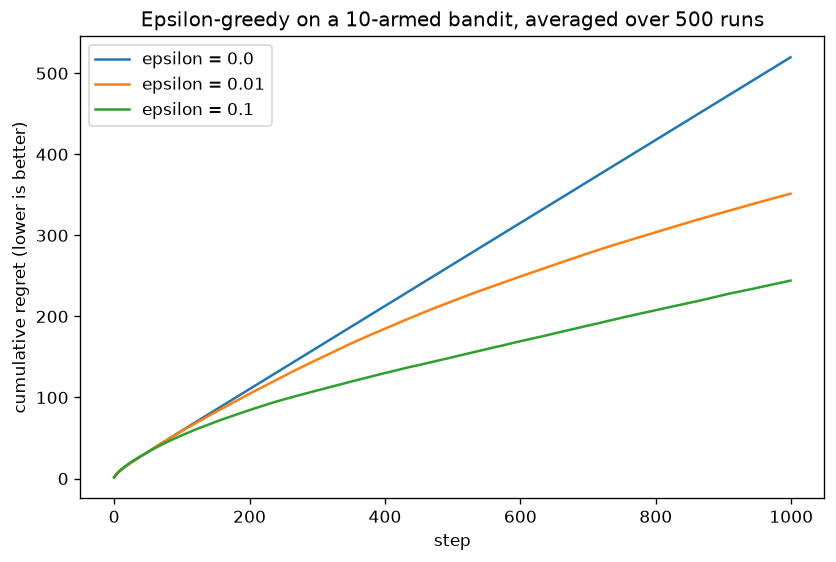

# Day 02: Bandits, epsilon-greedy and regret

## The idea
A **multi-armed bandit** is RL with one state. There are 10 slot machines (arms), and each one pays a random reward
around a hidden mean. You pull one arm per step and want the most reward overall. There's nothing to plan, but the
core tension of RL is already here:
- **exploit:** pull the arm that looks best so far;
- **explore:** try others, because "looks best" is an estimate built from a few noisy pulls.

**Epsilon-greedy** resolves it with a coin flip:

```
                 ┌── probability ε ───► pull a random arm          (explore)
each step ──────►┤
                 └── probability 1−ε ─► pull argmax_a Q(a)        (exploit, ties broken randomly)
```

`Q(a)` is the running average reward of arm `a`. It's updated incrementally, with no list of past rewards:

    Q(a) ← Q(a) + (reward − Q(a)) / N(a)        N(a) = times arm a has been pulled

**Regret** measures how much you lost by not knowing the best arm: the sum over steps of
`best_arm_mean − mean_of_the_arm_you_pulled`. Lower is better, and a good learner's regret curve bends flat.

## Run
    python day02_bandits_epsilon_greedy/epsilon_greedy_bandit.py

This runs 500 random 10-armed problems × 1000 steps for ε ∈ {0, 0.01, 0.1} and saves `regret.png` next to the
script. It takes about 20 s on a laptop CPU.

## Output (real run)
```
epsilon 0.0   | regret after 1000 steps:  519.7 | picks best arm (last 100 steps): 34.0%
epsilon 0.01  | regret after 1000 steps:  351.4 | picks best arm (last 100 steps): 57.5%
epsilon 0.1   | regret after 1000 steps:  244.3 | picks best arm (last 100 steps): 77.0%
```


- **Pure greedy (ε = 0)** locks onto whichever arm got lucky early. Its regret grows in a straight line forever, and
  it finds the best arm only 34% of the time.
- **ε = 0.1** explores enough to find the best arm 77% of the time, and its curve flattens.
- **ε = 0.01** learns slower but would overtake ε = 0.1 on a much longer run, because it wastes fewer pulls on
  exploration once it knows the answer.

## Dry run: the incremental update on rewards 2, 4, 9
The script asserts this before running anything:

| pull | reward | `count` | `running_estimate += (reward − running_estimate) / count` |
|---|---|---|---|
| – | – | 0 | 0.0 |
| 1 | 2.0 | 1 | 0 + (2 − 0)/1 = **2.0** |
| 2 | 4.0 | 2 | 2 + (4 − 2)/2 = **3.0** |
| 3 | 9.0 | 3 | 3 + (9 − 3)/3 = **5.0** |

The plain average is (2 + 4 + 9) / 3 = 5.0, so the two agree, and the update needs O(1) memory per arm.

**One step of `run_epsilon_greedy` with ε = 0.1:**
1. `random_generator.random()` returns 0.73. That's ≥ 0.1, so exploit.
2. `pick_greedy_arm` finds every arm tied at the maximum estimate. Early on all estimates are 0.0, so all 10 tie, and
   it picks one at random. `np.argmax` alone would always pick arm 0, which is a real bug in naive code.
3. It pulls that arm, and the reward is drawn from `normal(true_mean, 1)`.
4. `pull_counts[arm] += 1`, then `estimated_values[arm]` moves toward the reward by `1/pull_counts[arm]`.
5. Regret for this step = `best_arm_mean − true_arm_means[arm]`, which is 0 when it picked the best arm.

## Read
Sutton & Barto, *Reinforcement Learning: An Introduction*, ch. 2 (§2.1–2.4).
