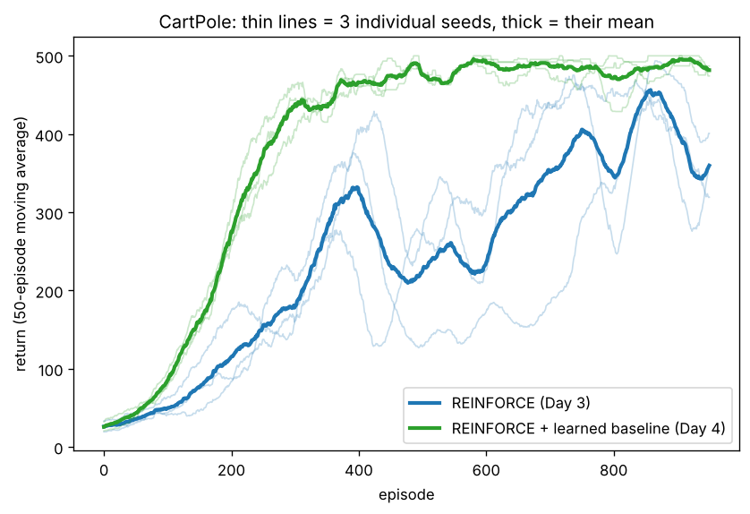

# Day 04: Baselines, advantage and the first critic

## The idea
Day 3's REINFORCE pushed every action by the **whole return** G_t. In CartPole every return is positive, so *every*
action gets made more likely. Good actions are pushed a bit harder, which is very noisy. The fix: subtract a
**baseline** b(s) that doesn't depend on the action:

    ∇J(θ) = E[ Σ_t (G_t − b(s_t)) · ∇ log π_θ(a_t | s_t) ]

The gradient stays **unbiased**, because E[∇log π · b(s)] = b(s) · ∇Σ_a π(a|s) = b(s) · ∇1 = 0, but the variance drops a
lot. The best simple baseline is the state value V(s), the return you *expected* from here. Then

    advantage A_t = G_t − V(s_t)     "how much better than expected was what actually happened?"

You learn V with a second network, the **critic**, by regression on G_t. Policy (actor) plus value (critic) gives you
**actor-critic**, the backbone of PPO (Day 5).

```
episode ──► returns G_t ──┬──► critic loss = mean (V(s_t) − G_t)²          (critic learns to predict G)
                          │
        V(s_t).detach() ──┴──► advantage A_t = G_t − V(s_t)
                                    │
                                    ▼
                         policy loss = − Σ_t A_t · log π(a_t|s_t)          (actor moves toward better-than-expected)
```
`detach()` matters: the policy loss must not push gradients into the critic, or the critic would learn to predict
whatever makes the policy loss small, not the return.

## Run
    for variant in plain baseline; do for seed in 0 1 2; do
      OMP_NUM_THREADS=1 python day04_baselines_advantage/reinforce_with_baseline.py $variant $seed &
    done; done; wait
    python day04_baselines_advantage/plot_comparison.py

That's 6 runs of 1000 episodes each, about 2 minutes in parallel on a laptop CPU. `OMP_NUM_THREADS=1` stops six torch
processes from fighting over cores. Needs `torch` (the CPU build is fine).

## Output (real run, 3 seeds each)
```
plain    seed 0: last-100 avg  359.6 | first episode reaching 500: 359
plain    seed 1: last-100 avg  434.5 | first episode reaching 500: 349
plain    seed 2: last-100 avg  352.3 | first episode reaching 500: 321
baseline seed 0: last-100 avg  485.5 | first episode reaching 500: 219
baseline seed 1: last-100 avg  484.0 | first episode reaching 500: 202
baseline seed 2: last-100 avg  493.4 | first episode reaching 500: 204
```


With a learned baseline, all 3 seeds end near the maximum of 500 (484–493, against 352–435 without one) and first
hit 500 about **130 episodes sooner**. The thin per-seed lines are also much tighter. That's the variance reduction
you can see.

## Dry run: one update with `use_baseline=True` on a 3-step episode
Example numbers: rewards `[1, 1, 1]`, γ = 0.99, and an untrained critic that predicts 2.5 everywhere.

1. `compute_returns_for_every_step([1, 1, 1], 0.99)` runs backwards: 1.0, then 1 + 0.99·1.0 = 1.99, then
   1 + 0.99·1.99 = 2.9701. So `returns = [2.9701, 1.99, 1.0]`.
2. `predicted_values = value_network(states)` gives `[2.5, 2.5, 2.5]`.
3. `advantages = returns − predicted_values.detach()` gives `[+0.47, −0.51, −1.50]`:
   - the first action did **better** than expected, so it becomes more likely;
   - the last two did **worse**, so they become less likely, even though their rewards were positive.

   Plain REINFORCE would have pushed all three up.
4. `value_loss = mean((V − G)²) = (0.47² + 0.51² + 1.5²)/3 ≈ 0.91`. One Adam step moves V toward
   `[2.97, 1.99, 1.0]`.
5. `policy_loss = −Σ advantages · log π(a_t|s_t)`. Then backward and step on the policy only, because the
   advantages are detached.

## Read
Sutton & Barto §13.4 (REINFORCE with baseline) and §13.5 (actor-critic).
